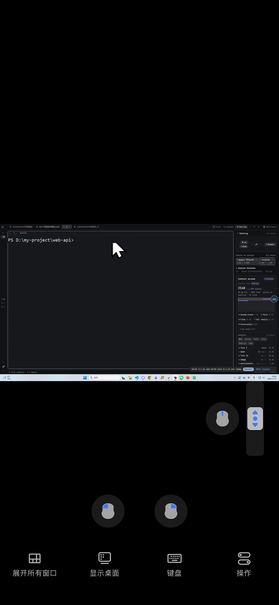
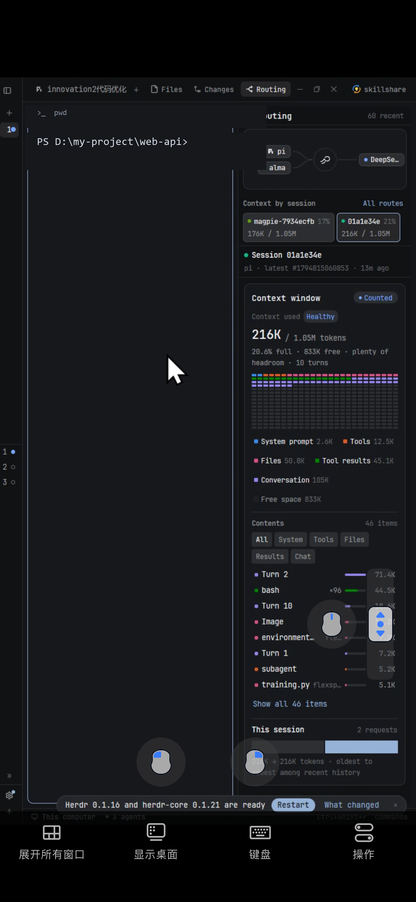

# PhoneCoding · 手机编程模式

[](#)
[](#)
[](LICENSE)
[](#)

> **One keystroke turns your monitor portrait and scales the desktop down, so remote-coding from your phone finally looks like a phone screen.**

用电脑横屏写代码、手机上远程看？按一下快捷键，显示器转 90 度、分辨率降到 720×1280，
等于把整个画面放大 1.5 倍。再按一次，精确还原。

| 用之前 | 用之后 |
|:---:|:---:|
|  |  |
| 横屏塞进手机，上下黑边，字小到看不清 | 竖屏填满，放大 1.5 倍，看得清 |

---

## 装

1. 下载 [最新 Release](../../releases/latest) 的 zip，解压
2. 双击 `install.bat`

不需要编译环境、不需要管理员权限。卸载跑 `uninstall.bat`。

> 首次运行 Windows 会弹 SmartScreen 警告 —— exe 没有代码签名（个人项目买证书太贵）。
> 点「更多信息 → 仍要运行」。源码全在 `src/`，不到 1500 行，没有任何联网行为。

## 用

| 操作 | 效果 |
|---|---|
| `Ctrl + Alt + P` | 竖屏 ↔ 横屏 |
| 双击托盘图标 | 同上 |
| 右键托盘图标 | 换倍数 / 换屏 / 换方向 / 换快捷键 |

快捷键被别的软件占了会自动换一条，实际生效的键写在托盘悬浮提示里。

**放大倍数**：默认 1.5 倍（720×1280）。想再看大点用 664×1176，想多几行代码用 800×1280。
菜单里列出的都是这块屏**真实支持**的档位，不是随便填的数字。

## 两个坑

**先在本机切竖屏，再连手机。** 顺序反了，远程软件可能还缓存着旧的宽高比。

**改的是分辨率，不是系统缩放。** 系统缩放要重新登录才彻底生效，还会把所有程序的窗口一起放大；
改分辨率是即时的，串流出去的画面宽度真的只有 720，手机上就是大字。

---

## 命令行

```bat
PhoneCoding.exe list      :: 列出显示器和可用档位
PhoneCoding.exe on / off  :: 进入 / 还原
PhoneCoding.exe status    :: 当前状态
```

配置在 `%APPDATA%\PhoneCoding\config.ini`，出问题看同目录的 `log.txt`。

## 自己编译

```bat
build.bat
```

用 Win10/11 自带的 `csc.exe`，不需要 Visual Studio 或 .NET SDK。

## License

MIT
